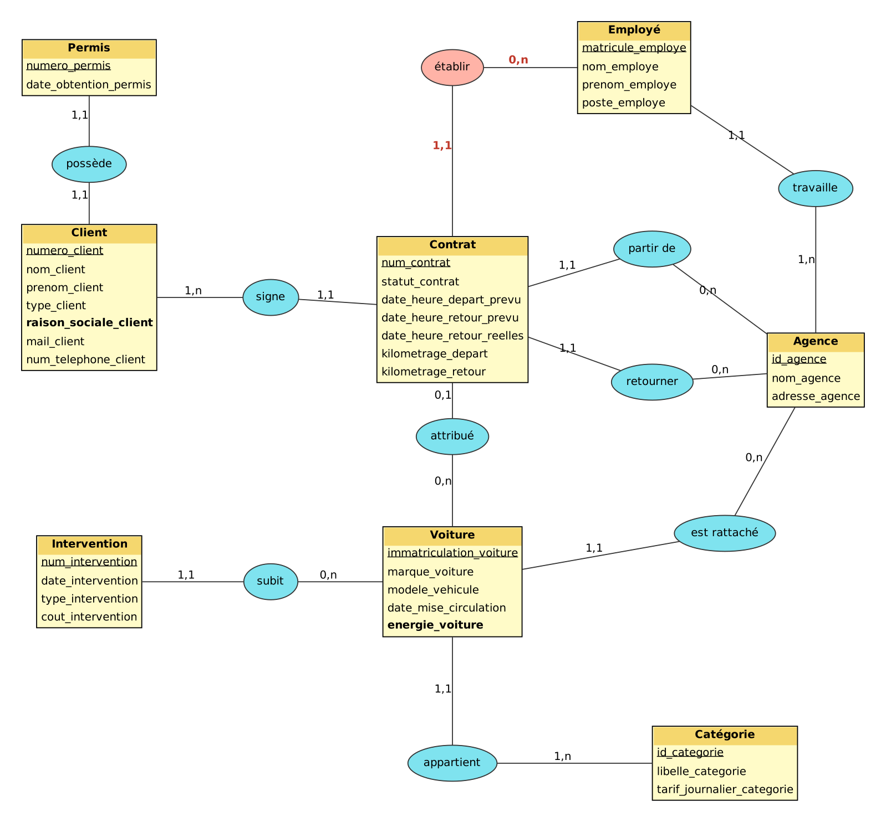

# Mini_projet_BDD

Domaine : location et gestion de flotte automobile (entreprise comparable à Sixt, Hertz ou Europcar).

## Sommaire

1. [Étape 1 : analyse des besoins](#étape-1--analyse-des-besoins)
2. [Étape 2 : MCD](#étape-2--mcd)
3. [Étape 3 : MLD, MPD et contraintes additionnelles](#étape-3--mld-mpd-et-contraintes-additionnelles)
4. [Étape 4 : insertion des données](#étape-4--insertion-des-données)
5. [Étape 5 : interroger la base](#étape-5--interroger-la-base)

## Organisation du dépôt

| Dossier / fichier | Contenu |
|---|---|
| `prompt/prompt_etape1_analyse.txt` | prompt de l'étape 1 (règles de gestion et dictionnaire) |
| `prompt/prompt_etape4_insertion.txt` | prompt de l'étape 4 (génération des données) |
| `mcdprojet/MCD.loo` | fichier source Looping du MCD |
| `mcdprojet/mcd_v2_reference.png` | image du MCD |
| `sql/01_creation_tables.sql` | MPD : tables, clés, `ON DELETE` / `ON UPDATE` |
| `sql/02_contraintes.sql` | contraintes additionnelles (`UNIQUE`, `CHECK`) |
| `sql/03_insertion_donnees.sql` | jeu de données |
| `sql/04_controles_donnees.sql` | contrôle des règles de gestion sur les données |
| `sql/05_requetes_scenario.sql` | requêtes du scénario d'utilisation |
| `sql/tests_contraintes.sql` | requêtes invalides et démonstration des cascades |

Correspondance avec les noms de l'énoncé : `01_creation_tables.sql` = `1_creation.sql`, `02_contraintes.sql` = `2_contraintes.sql`, `03_insertion_donnees.sql` = `3_insertion.sql`, `05_requetes_scenario.sql` = `4_interrogation.sql`.

## Étape 1 : analyse des besoins

### 1.1 Prompt utilisé (framework RICARDO)

Le prompt complète la base fournie par l'enseignante. Nous avons ajouté le **Contexte** (domaine, type d'entreprise, activités, données collectées) et les **Références** (site sixt.fr, articles sur la gestion de flotte).

```text
Tu travailles dans le domaine de la location et de la gestion de flotte automobile. Ton entreprise a comme activité de louer des véhicules légers et utilitaires à des particuliers et à des professionnels, de gérer les contrats de réservation, le suivi de la maintenance ainsi que le réseau d'agences. C'est une entreprise comme Sixt, Hertz ou Europcar. Des données ont été collectées sur : les clients, les véhicules et leurs catégories, les agences de départ et d'arrivée, les contrats de location, le personnel d'agence, ainsi que les entretiens et réparations des véhicules. Inspire-toi du site web / des offres de location présentés sur https://www.sixt.fr et des articles de présentation des services de gestion de flotte automobile.

Ton entreprise veut appliquer MERISE pour concevoir un système d'information. Tu es chargé de la partie analyse, c'est-à-dire de collecter les besoins auprès de l'entreprise. Elle a fait appel à un étudiant en ingénierie informatique pour réaliser ce projet, tu dois lui fournir les informations nécessaires pour qu'il applique ensuite lui-même les étapes suivantes de conception et développement de la base de données.

D'abord, établis les règles de gestions des données de ton entreprise, sous la forme d'une liste à puces. Elles doivent correspondre aux informations que fournit quelqu'un qui connaît le fonctionnement de l'entreprise, mais pas comment se construit un système d'information.

Ensuite, à partir de ces règles, fournis un dictionnaire de données brutes avec les colonnes suivantes, regroupées dans un tableau : signification de la donnée, type, taille en nombre de caractères ou de chiffres. Il doit y avoir entre 25 et 35 données. Il sert à fournir des informations supplémentaires sur chaque donnée (taille et type) mais sans a priori sur comment les données vont être modélisées ensuite.

Fournis donc les règles de gestion et le dictionnaire de données.
```

Le prompt est aussi enregistré dans `prompt/prompt_etape1_analyse.txt`.

### 1.2 Règles de gestion obtenues

**Clients**
- Un client est soit un particulier, soit un professionnel (entreprise). Pour un professionnel, on enregistre aussi sa raison sociale.
- Chaque client a un numéro unique. On garde son nom, son prénom, son adresse e-mail et son numéro de téléphone.
- Pour louer, le client doit présenter un permis de conduire valide. On relève son numéro et sa date d'obtention.
- Le permis doit avoir au moins 1 an, et au moins 2 ans pour les véhicules haut de gamme et les grands utilitaires.
- Un client peut signer plusieurs contrats au fil du temps, mais un contrat ne concerne qu'un seul client.

**Véhicules et catégories**
- Chaque véhicule est identifié par son immatriculation. On connaît sa marque, son modèle, sa date de mise en circulation et son énergie (essence, diesel, hybride, électrique).
- Chaque véhicule appartient à une seule catégorie (citadine, berline, SUV, utilitaire 12 m³…). Une catégorie regroupe plusieurs véhicules.
- Une catégorie a un code à 4 caractères (norme ACRISS utilisée par les loueurs), un libellé et un tarif journalier.
- Le tarif dépend de la catégorie, pas du véhicule précis.
- À la réservation, le client choisit une catégorie. Le véhicule précis lui est attribué au moment du départ.
- Chaque véhicule est rattaché à une agence d'attache.

**Agences et personnel**
- Chaque agence a un code, un nom et une adresse.
- Un employé travaille dans une seule agence, et une agence emploie plusieurs employés.
- Pour chaque employé, on connaît son matricule, son nom, son prénom et son poste (agent de comptoir, préparateur, responsable d'agence…).

**Contrats de location**
- Chaque contrat a un numéro unique et porte sur un seul véhicule.
- Le contrat est établi par un employé de l'agence de départ.
- Il précise une agence de départ et une agence de retour. Elles peuvent être différentes (location aller simple).
- On note la date et l'heure de départ prévues, la date et l'heure de retour prévues, puis la date et l'heure de retour réelles.
- Le kilométrage est relevé au départ et au retour.
- Un contrat passe par les statuts : réservé, en cours, clôturé ou annulé.
- Un véhicule ne peut pas faire l'objet de deux locations en cours en même temps.
- Le prix d'une location se calcule à partir du tarif journalier de la catégorie et de la durée de location.

**Maintenance**
- Un véhicule peut subir plusieurs interventions, et chaque intervention concerne un seul véhicule.
- Une intervention est soit un entretien (vidange, révision, pneus), soit une réparation (carrosserie, panne).
- Pour chaque intervention, on enregistre un numéro, une date, un type et un coût.
- Un véhicule en intervention ne peut pas être loué.

### 1.3 Dictionnaire de données obtenu

Types : A = alphabétique, AN = alphanumérique, N = numérique, D = date, DH = date et heure.

| # | Signification | Type | Taille |
|---|---|---|---|
| 1 | Numéro du client | AN | 8 |
| 2 | Nom du client | A | 50 |
| 3 | Prénom du client | A | 50 |
| 4 | Type de client (particulier/professionnel) | A | 13 |
| 5 | Raison sociale du client professionnel | AN | 100 |
| 6 | Adresse e-mail du client | AN | 100 |
| 7 | Téléphone du client | AN | 15 |
| 8 | Numéro de permis de conduire | AN | 20 |
| 9 | Date d'obtention du permis | D | 10 |
| 10 | Code de la catégorie de véhicule | AN | 4 |
| 11 | Libellé de la catégorie | AN | 50 |
| 12 | Tarif journalier de la catégorie (€) | N | 6 (dont 2 déc.) |
| 13 | Immatriculation du véhicule | AN | 9 |
| 14 | Marque du véhicule | AN | 30 |
| 15 | Modèle du véhicule | AN | 30 |
| 16 | Date de mise en circulation | D | 10 |
| 17 | Énergie du véhicule | A | 20 |
| 18 | Code de l'agence | AN | 6 |
| 19 | Nom de l'agence | AN | 50 |
| 20 | Adresse de l'agence | AN | 150 |
| 21 | Matricule de l'employé | AN | 8 |
| 22 | Nom de l'employé | A | 50 |
| 23 | Prénom de l'employé | A | 50 |
| 24 | Poste de l'employé | A | 30 |
| 25 | Numéro du contrat | AN | 12 |
| 26 | Date et heure de départ prévues | DH | 16 |
| 27 | Date et heure de retour prévues | DH | 16 |
| 28 | Date et heure de retour réelles | DH | 16 |
| 29 | Kilométrage au départ | N | 7 |
| 30 | Kilométrage au retour | N | 7 |
| 31 | Statut du contrat | A | 10 |
| 32 | Numéro de l'intervention | AN | 10 |
| 33 | Date de l'intervention | D | 10 |
| 34 | Type d'intervention | A | 30 |
| 35 | Coût de l'intervention (€) | N | 8 (dont 2 déc.) |

### 1.4 Analyse du résultat

- **35 données** : c'est dans la fourchette demandée (25 à 35).
- Chaque donnée a une signification, un type et une taille. Les types sont cohérents : par exemple, le téléphone et le numéro de permis sont alphanumériques, parce qu'on ne fait pas de calcul dessus et qu'ils peuvent commencer par 0.
- Les règles sont formulées comme le ferait quelqu'un du métier, sans vocabulaire MERISE.
- Les données calculées (montant d'une location, durée) ne sont pas dans le dictionnaire, puisqu'elles se déduisent des autres. C'est voulu.

Nous n'avons pas eu besoin de relancer le prompt.

## Étape 2 : MCD

### 2.1 MCD



Fichier source Looping : `mcdprojet/MCD.loo`. La version rendue le 16/10 reste consultable dans l'historique des commits.

**Entités** (identifiant souligné) :
- **Permis** (<u>numero_permis</u>, date_obtention_permis)
- **Client** (<u>numero_client</u>, nom_client, prenom_client, type_client, raison_sociale_client, mail_client, num_telephone_client)
- **Employé** (<u>matricule_employe</u>, nom_employe, prenom_employe, poste_employe)
- **Agence** (<u>id_agence</u>, nom_agence, adresse_agence)
- **Contrat** (<u>num_contrat</u>, statut_contrat, date_heure_depart_prevu, date_heure_retour_prevu, date_heure_retour_reelles, kilometrage_depart, kilometrage_retour)
- **Voiture** (<u>immatriculation_voiture</u>, marque_voiture, modele_vehicule, date_mise_circulation, energie_voiture)
- **Catégorie** (<u>id_categorie</u>, libelle_categorie, tarif_journalier_categorie)
- **Intervention** (<u>num_intervention</u>, date_intervention, type_intervention, cout_intervention)

**Associations :**

| Association | Entité A | Card. A | Card. B | Entité B | Lecture |
|---|---|---|---|---|---|
| possède | Permis | 1,1 | 1,1 | Client | un client a un seul permis, un permis appartient à un seul client |
| signe | Client | 1,n | 1,1 | Contrat | un client signe au moins un contrat, un contrat a un seul client |
| établir | Employé | 0,n | 1,1 | Contrat | un employé établit 0 ou plusieurs contrats, un contrat est établi par un seul employé |
| travaille | Employé | 1,1 | 1,n | Agence | un employé travaille dans une agence, une agence a au moins un employé |
| partir de | Contrat | 1,1 | 0,n | Agence | un contrat a une agence de départ |
| retourner | Contrat | 1,1 | 0,n | Agence | un contrat a une agence de retour |
| attribué | Contrat | 0,1 | 0,n | Voiture | le véhicule n'est attribué qu'au départ, d'où le 0 |
| subit | Intervention | 1,1 | 0,n | Voiture | une intervention concerne un seul véhicule |
| est rattaché | Voiture | 1,1 | 0,n | Agence | un véhicule a une agence d'attache |
| appartient | Voiture | 1,1 | 1,n | Catégorie | un véhicule a une catégorie, une catégorie regroupe au moins un véhicule |

### 2.2 Normalisation

- **1FN** : chaque attribut contient une seule valeur, sans liste ni groupe répétitif. Chaque entité a un identifiant.
- **2FN** : tous les identifiants sont composés d'un seul attribut. Aucun attribut ne peut donc dépendre d'une partie seulement de l'identifiant.
- **3FN** : aucun attribut non identifiant ne dépend d'un autre attribut non identifiant. Par exemple, le tarif journalier dépend de la catégorie et non du véhicule : il est donc dans **Catégorie** et pas dans Voiture (règle « le tarif dépend de la catégorie, pas du véhicule précis »). De même, les informations d'agence sont dans **Agence** et ne sont pas recopiées dans Contrat ou dans Voiture.
- Les **données calculées** (montant, durée de location) ne sont pas stockées.

### 2.3 Corrections par rapport au MCD rendu le 16/10

Le sujet autorise à corriger le MCD après le premier rendu. Nous n'avons rien ajouté de nouveau, nous avons seulement corrigé les erreurs :

| # | Correction | Raison |
|---|---|---|
| 1 | Cardinalités de **« établir »** : Employé **0,n** (avant 1,1), Contrat **1,1** (avant 1,n) | L'ancienne version disait qu'un employé établit un seul contrat dans sa vie, et qu'un contrat peut être établi par plusieurs employés. Le 0 vient de ce que les préparateurs n'établissent pas de contrat. |
| 2 | Ajout de **raison_sociale_client** dans Client | Donnée n°5 du dictionnaire, oubliée. Le sujet impose d'intégrer toutes les données du dictionnaire. |
| 3 | Ajout de **energie_voiture** dans Voiture | Donnée n°17 du dictionnaire, oubliée. |
| 4 | Noms d'attributs **sans accents** (`numero_permis`, `modele_vehicule`) | Pour qu'ils deviennent des noms de colonnes SQL valides sans guillemets. |

## Étape 3 : MLD, MPD et contraintes additionnelles

**Fichiers :**
- `sql/01_creation_tables.sql` : création des tables (MPD), avec clés primaires, clés étrangères (`ON DELETE` / `ON UPDATE`) et `NOT NULL`
- `sql/02_contraintes.sql` : contraintes additionnelles (`UNIQUE` et `CHECK`), ajoutées par `ALTER TABLE`
- `sql/tests_contraintes.sql` : 21 requêtes invalides, qui doivent toutes être rejetées, et une démonstration des cascades

**SGBD :** MySQL 8.0.16 ou plus récent. Avant cette version, MySQL accepte les `CHECK` mais ne les applique pas.

### 3.1 Modèle logique de données (MLD)

Obtenu à partir du MCD de l'étape 2. Notation : **clé primaire** en gras, `#` = clé étrangère.

- **AGENCE** (**id_agence**, nom_agence, adresse_agence)
- **CATEGORIE** (**id_categorie**, libelle_categorie, tarif_journalier_categorie)
- **PERMIS** (**numero_permis**, date_obtention_permis)
- **CLIENT** (**numero_client**, nom_client, prenom_client, type_client, raison_sociale_client, mail_client, num_telephone_client, #numero_permis)
- **EMPLOYE** (**matricule_employe**, nom_employe, prenom_employe, poste_employe, #id_agence)
- **VOITURE** (**immatriculation_voiture**, marque_voiture, modele_vehicule, date_mise_circulation, energie_voiture, #id_categorie, #id_agence)
- **CONTRAT** (**num_contrat**, statut_contrat, date_heure_depart_prevu, date_heure_retour_prevu, date_heure_retour_reelles, kilometrage_depart, kilometrage_retour, #numero_client, #matricule_employe, #id_agence_depart, #id_agence_retour, #immatriculation_voiture)
- **INTERVENTION** (**num_intervention**, date_intervention, type_intervention, cout_intervention, #immatriculation_voiture)

### 3.2 Règles de passage MCD → MLD

1. Chaque **entité** devient une **relation** (une table). Son identifiant devient la clé primaire.
2. Pour une association **x,1 – x,n**, l'identifiant de l'entité côté *n* devient une **clé étrangère** dans l'entité côté *1*. L'association disparaît.
3. Si la cardinalité côté *1* est **0,1**, la clé étrangère peut être `NULL`. Si elle est **1,1**, elle est `NOT NULL`.
4. Pour une association **1,1 – 1,1**, la clé étrangère va d'un côté au choix, avec une contrainte `UNIQUE`.

| Association | Cardinalités | Traduction |
|---|---|---|
| possède (Client – Permis) | 1,1 – 1,1 | `numero_permis` dans CLIENT, `NOT NULL` + `UNIQUE` (règle 4) |
| signe (Client – Contrat) | 1,n – 1,1 | `numero_client` dans CONTRAT, `NOT NULL` |
| établir (Employé – Contrat) | 0,n – 1,1 | `matricule_employe` dans CONTRAT, `NOT NULL` |
| partir de (Contrat – Agence) | 1,1 – 0,n | `id_agence_depart` dans CONTRAT, `NOT NULL` |
| retourner (Contrat – Agence) | 1,1 – 0,n | `id_agence_retour` dans CONTRAT, `NOT NULL`. Ce sont deux associations vers la même entité, donc deux clés étrangères distinctes vers AGENCE. |
| attribué (Contrat – Voiture) | 0,1 – 0,n | `immatriculation_voiture` dans CONTRAT, **`NULL` autorisé** : une réservation n'a pas encore de véhicule (règle 3) |
| travaille (Employé – Agence) | 1,1 – 1,n | `id_agence` dans EMPLOYE, `NOT NULL` |
| appartient (Voiture – Catégorie) | 1,1 – 1,n | `id_categorie` dans VOITURE, `NOT NULL` |
| est rattaché (Voiture – Agence) | 1,1 – 0,n | `id_agence` dans VOITURE, `NOT NULL` |
| subit (Intervention – Voiture) | 1,1 – 0,n | `immatriculation_voiture` dans INTERVENTION, `NOT NULL` |

### 3.3 Modèle physique (MPD) : choix des types

Les types et les tailles viennent du dictionnaire de données :

| Dictionnaire | Type MySQL | Exemple |
|---|---|---|
| A / AN, taille fixe | `CHAR(n)` | code catégorie ACRISS : `CHAR(4)` |
| A / AN, taille variable | `VARCHAR(n)` | nom `VARCHAR(50)`, immatriculation `VARCHAR(9)` |
| N entier | `INT` | kilométrages (7 chiffres) |
| N décimal | `DECIMAL(p,2)` | tarif `DECIMAL(6,2)`, coût `DECIMAL(8,2)` |
| D | `DATE` | date d'obtention du permis |
| DH | `DATETIME` | dates et heures des contrats |

- Les montants sont en `DECIMAL`, pas en `FLOAT` : les valeurs sont exactes, sans erreur d'arrondi.
- Les téléphones et numéros de permis restent du texte : on ne fait pas de calcul dessus, et ils peuvent commencer par 0.
- Toutes les contraintes portent un nom (`pk_`, `fk_`, `uq_`, `ck_`), ce qui rend les messages d'erreur lisibles.
- Le montant et la durée d'une location ne sont pas stockés : ce sont des données calculées (3FN). L'étape 5 les calcule.

### 3.4 Modification et suppression d'un enregistrement référencé

Chaque clé étrangère précise ce qui se passe quand la ligne référencée est modifiée ou supprimée, pour que l'opération se fasse sans erreur :

| Clé étrangère | `ON UPDATE` | `ON DELETE` | Raison |
|---|---|---|---|
| `client.numero_permis` → PERMIS | `CASCADE` | `CASCADE` | possède est en 1,1 – 1,1 : un client n'existe pas sans son permis |
| `employe.id_agence` → AGENCE | `CASCADE` | `CASCADE` | un employé travaille obligatoirement dans une agence (1,1) |
| `voiture.id_categorie` → CATEGORIE | `CASCADE` | `CASCADE` | un véhicule a obligatoirement une catégorie (1,1) |
| `voiture.id_agence` → AGENCE | `CASCADE` | `CASCADE` | un véhicule a obligatoirement une agence d'attache (1,1) |
| `contrat.numero_client` → CLIENT | `CASCADE` | `CASCADE` | un contrat a obligatoirement un client (1,1) |
| `contrat.matricule_employe` → EMPLOYE | `CASCADE` | `CASCADE` | un contrat a obligatoirement un employé (1,1) |
| `contrat.id_agence_depart` / `id_agence_retour` → AGENCE | `CASCADE` | `CASCADE` | un contrat a obligatoirement ses deux agences (1,1) |
| `contrat.immatriculation_voiture` → VOITURE | `CASCADE` | **`SET NULL`** | attribué est en **0,1** : le contrat reste valable sans véhicule, on garde l'historique client |
| `intervention.immatriculation_voiture` → VOITURE | `CASCADE` | `CASCADE` | une intervention n'a pas de sens sans son véhicule |

Règle suivie : `SET NULL` seulement quand la clé étrangère peut être nulle (cardinalité 0,1). Pour les cardinalités 1,1, la colonne est `NOT NULL`, et MySQL n'accepte alors que `CASCADE`.

`ON UPDATE CASCADE` recopie automatiquement un identifiant modifié (par exemple un numéro de permis corrigé) dans toutes les tables qui le référencent.

**Contrainte de MySQL :** une colonne utilisée par une clé étrangère en `CASCADE` ou `SET NULL` ne peut pas apparaître dans un `CHECK` (erreur 3823). La contrainte `ck_contrat_depart_effectue` ne vérifie donc plus que le kilométrage de départ. La présence du véhicule pour une location en cours ou clôturée est contrôlée par la règle R6 de `04_controles_donnees.sql`.

### 3.5 Contraintes additionnelles (`02_contraintes.sql`)

Au-delà des clés et des `NOT NULL` qui viennent du MLD, nous avons traduit les règles de gestion de l'étape 1 en contraintes `UNIQUE` et `CHECK` :

| Règle de gestion (étape 1) | Contrainte |
|---|---|
| Un client est soit un particulier, soit un professionnel | `ck_client_type` |
| Pour un professionnel, on enregistre sa raison sociale | `ck_client_raison_sociale` : obligatoire pour un pro, absente pour un particulier |
| Adresse e-mail du client | `ck_client_mail` (format texte@texte.texte), `uq_client_mail` (unique) |
| Un permis appartient à un seul client (possède 1,1 – 1,1) | `uq_client_permis` |
| Code catégorie à 4 caractères (ACRISS) | `ck_categorie_code` |
| Deux catégories n'ont pas le même libellé | `uq_categorie_libelle` |
| Le tarif journalier est positif | `ck_categorie_tarif` |
| Poste : agent de comptoir, préparateur, responsable d'agence… | `ck_employe_poste` |
| Immatriculation (format SIV AB-123-CD) | `ck_voiture_immat` |
| Énergie : essence, diesel, hybride, électrique | `ck_voiture_energie` |
| Statuts : réservé, en cours, clôturé, annulé | `ck_contrat_statut` |
| Retour prévu et retour réel après le départ | `ck_contrat_dates_prevues`, `ck_contrat_date_reelle` |
| Kilométrage relevé au départ et au retour | `ck_contrat_km_positifs`, `ck_contrat_km_coherents` (retour ≥ départ) |
| Le véhicule est attribué au départ | `ck_contrat_depart_effectue` : une location en cours ou clôturée a un km de départ (le véhicule est contrôlé par R6, voir 3.4) |
| — | `ck_contrat_pas_de_retour_avant_depart` : une réservation n'a pas encore de retour |
| — | `ck_contrat_cloture` : un contrat clôturé a une date et un km de retour |
| Intervention : entretien (vidange, révision, pneus) ou réparation (carrosserie, panne) | `ck_intervention_type` |
| Coût d'une intervention | `ck_intervention_cout` (≥ 0) |
| Formats des identifiants (dictionnaire) | `ck_client_numero`, `ck_employe_matricule`, `ck_contrat_numero`, `ck_intervention_numero` |

### 3.6 Règles qu'un `CHECK` ne peut pas vérifier

Un `CHECK` ne voit que la ligne en cours d'écriture. Il ne peut donc pas comparer plusieurs lignes ni lire une autre table. Les règles suivantes ne sont pas imposées par la base :

- le contrat est établi par un employé **de l'agence de départ** (il faut lire la table EMPLOYE) ;
- le permis a **au moins 1 an**, ou 2 ans pour le haut de gamme (il faut lire PERMIS et CATEGORIE) ;
- un véhicule ne peut pas avoir **deux locations en même temps** (il faut comparer plusieurs contrats) ;
- un véhicule **en intervention** ne peut pas être loué (il faut lire INTERVENTION) ;
- les **cardinalités minimales 1** côté « n » (un client a au moins un contrat, etc.) : une clé étrangère ne garantit que le côté 1,1.

Nous les vérifions autrement :
- **sur les données insérées**, avec les requêtes de contrôle de `04_controles_donnees.sql` (étape 4), qui renvoient toutes 0 anomalie ;
- **au moment d'une opération**, avec une requête de vérification exécutée avant d'écrire (étape 5 : A2 vérifie qu'un véhicule est libre avant de l'attribuer, A5 vérifie l'ancienneté du permis avant la réservation).

### 3.7 Tests des contraintes (`tests_contraintes.sql`)

21 requêtes violent volontairement une contrainte chacune : clé primaire, clé étrangère, `NOT NULL`, les deux `UNIQUE` et 16 `CHECK`. Toutes sont rejetées, avec le message indiqué en commentaire au-dessus de chacune.

Le fichier contient aussi une démonstration des actions référentielles, dans une transaction annulée par `ROLLBACK` : changer un numéro de permis le modifie aussi dans CLIENT (`ON UPDATE CASCADE`), et supprimer la Fiat 500 GA-214-KL supprime son intervention (`ON DELETE CASCADE`) mais garde ses contrats, qui passent sans véhicule (`ON DELETE SET NULL`). Ce fichier s'exécute juste après `03` (avant `05`, qui modifie des contrats utilisés par les tests), en continuant malgré les erreurs (`mysql --force`, ou décocher « Stop script execution on errors » dans MySQL Workbench).

### 3.8 Exécution

```sql
CREATE DATABASE location_auto CHARACTER SET utf8mb4 COLLATE utf8mb4_general_ci;
USE location_auto;
```

Ensuite, exécuter dans l'ordre : `01_creation_tables.sql` → `02_contraintes.sql` → `03_insertion_donnees.sql` → `04_controles_donnees.sql` → `05_requetes_scenario.sql`. Pour tout recommencer, il suffit de relancer à partir de `01`, qui supprime les tables existantes.

## Étape 4 : insertion des données

**Fichiers :**
- `prompt/prompt_etape4_insertion.txt` : prompt utilisé
- `sql/03_insertion_donnees.sql` : les données
- `sql/04_controles_donnees.sql` : la vérification des données

### 4.1 Démarche

Nous avons demandé les données à l'IAG avec un prompt structuré selon le framework RICARDO, comme à l'étape 1. Le prompt lui donne :
- en **références**, les scripts de création des tables et des contraintes, pour qu'elle connaisse exactement les colonnes, les types et les `CHECK` ;
- une **date de référence fixe** (samedi 7 novembre 2026, 10h00), pour que les statuts « en cours », « réservé » et les retards aient un sens ;
- les **règles de gestion qu'aucune contrainte SQL ne vérifie** (voir 3.6), pour que les données les respectent quand même ;
- les **situations particulières** dont le scénario de l'étape 5 a besoin : une location en retard, des allers simples, des réservations à venir, de jeunes conducteurs, des interventions planifiées.

### 4.2 Contenu de la base

| Table | Lignes | Remarques |
|---|---|---|
| agence | 6 | 2 gares parisiennes, 2 aéroports, Lyon, Marseille |
| categorie | 7 | codes ACRISS, de la Mini (34,90 €/jour) à la berline premium (129 €/jour) |
| permis | 20 | dont 2 permis récents (15/06/2025 et 02/12/2024) |
| client | 20 | 14 particuliers, 6 professionnels |
| employe | 22 | dans chaque agence : 1 responsable, des agents de comptoir et un préparateur, plus 2 mécaniciens |
| voiture | 24 | vrais modèles (Clio, 208, 3008, Master, Tesla Model 3…) |
| contrat | 82 | 67 clôturés, 6 en cours, 6 réservés, 3 annulés |
| intervention | 32 | dont 4 planifiées après le 07/11 |

Toutes les données sont fictives. Les e-mails sont en `@exemple.fr`.

### 4.3 Vérification des données générées

**1. Les contraintes SQL.** Le script `03` s'exécute après `01` et `02`. Chaque ligne passe donc par les clés, les `NOT NULL`, les `UNIQUE` et les `CHECK`. Le script s'exécute **sans aucune erreur**.

**2. Les règles de gestion inter-tables.** Le fichier `04_controles_donnees.sql` compte, pour chaque règle, le nombre de lignes qui ne la respectent pas. Résultat obtenu :

| Règle contrôlée | Anomalies |
|---|---|
| R1 : contrat établi par un employé d'une autre agence | 0 |
| R2 : permis trop récent au moment du départ (1 an, ou 2 ans pour PDAR et FKMD) | 0 |
| R3 : deux locations du même véhicule qui se chevauchent | 0 |
| R4 : intervention pendant une location du véhicule | 0 |
| R5 : compteur qui recule entre deux locations du même véhicule | 0 |
| MCD : client sans contrat (signe 1,n) | 0 |
| MCD : catégorie sans véhicule (appartient 1,n) | 0 |
| MCD : agence sans employé (travaille 1,n) | 0 |
| R6 : location en cours ou clôturée sans véhicule | 0 |

Pour nous assurer que ces requêtes détectent vraiment les erreurs, nous avons inséré dans une transaction, ensuite annulée (`ROLLBACK`), un contrat établi par un employé d'une autre agence, une berline premium louée par une conductrice qui a son permis depuis moins de 2 ans, une location qui en chevauche une autre et une intervention pendant une location. Chaque contrôle est alors passé de 0 à au moins 1.

**3. La variété des situations** : 14 retours en retard parmi les locations clôturées, 12 locations aller simple, 1 location en cours en retard (CT2026-00071), 2 annulations de plus de 6 mois.

### 4.4 Problèmes relevés et corrections

| Problème | Correction |
|---|---|
| Le premier jeu contenait plus de 150 contrats, trop pour être relu et vérifié | Nous avons réduit la période (juillet → novembre) et espacé les locations : 82 contrats |
| Une intervention pouvait tomber pendant une location en cours (règle R4 non respectée) | Nous avons supprimé les interventions concernées |
| Un client fictif portait le nom d'une personnalité connue | Nous l'avons remplacé par un nom neutre |

## Étape 5 : interroger la base

**Fichier :** `sql/05_requetes_scenario.sql` (28 requêtes, à exécuter dans l'ordre, après 01, 02 et 03)

### 5.1 Scénario

On suit **une semaine à l'agence Paris Gare de Lyon (PAR01), du samedi 7 au samedi 14 novembre 2026**, puis le siège fait le bilan de l'activité du réseau. La « date du jour » est écrite en dur dans les requêtes (`2026-11-07 10:00`) : les résultats sont les mêmes quel que soit le jour d'exécution.

**Partie A : au comptoir.** Le samedi matin, Karim, agent de comptoir, regarde les départs de la semaine (A1). Inès Bonnet a réservé du 10 au 14 novembre et veut une citadine. Karim cherche une citadine présente à l'agence et libre sur cette période (A2). Les deux citadines de l'agence ne sont pas disponibles (A3) : la 208 n'a toujours pas été rendue (sa cliente a 2 jours de retard, A4) et la Clio part en révision le 13. Par contre, une Clio de l'agence de Lyon est garée à PAR01 depuis une location aller simple. Pendant ce temps, l'entreprise Batiself appelle pour louer un utilitaire de 12 m³. Karim vérifie que son conducteur a bien 2 ans de permis (A5), puis enregistre la réservation (A6). Le mardi, Inès part avec la Clio lyonnaise (A7). Elle la rend le samedi (A8), et Karim édite la facture (A9).

**Partie B : la responsable d'agence organise la semaine.** Elle repère les véhicules à rapatrier (B1), consulte le planning des interventions (B2), les effectifs du réseau (B3) et le nombre de contrats établis par chaque membre de son équipe (B4).

**Partie C : le siège analyse l'activité.** Chiffre d'affaires par agence (C1), activité et retards par catégorie (C2), rentabilité des véhicules (C3), meilleurs clients professionnels (C4), clients à relancer (C5), trajets aller simple (C6).

**Partie E : questions complémentaires du siège.** Marques hybrides et électriques de la flotte (E1), utilitaires des agences parisiennes (E2), clients qui ont déjà loué une berline premium (E3), véhicules sans location depuis le 1er octobre (E4), véhicule le plus coûteux en maintenance (E5), catégories plus chères qu'un utilitaire (E6), véhicules passés au moins 2 fois en atelier (E7).

**Partie D : mises à jour.** Hausse du tarif des SUV (D1), puis purge des vieilles annulations (D2).

### 5.2 Requêtes et notions SQL utilisées

| Requête | Besoin | Notions SQL | Résultat |
|---|---|---|---|
| A1 | Réservations de la semaine à PAR01 | jointure, `BETWEEN` | CT2026-00076 (Inès Bonnet) |
| A2 | Citadines présentes à PAR01 et libres du 10 au 14/11 | sous-requêtes scalaires (`ORDER BY … LIMIT 1`), `NOT EXISTS`, `COALESCE` | GP-873-LC (Lyon) et GL-519-AZ (CDG) |
| A3 | Pourquoi les citadines de PAR01 ne sont pas libres | `LEFT JOIN` avec condition, sous-requête corrélée `MIN` | 208 en location, Clio en révision le 13/11 |
| A4 | Locations en retard dans tout le réseau | `DATEDIFF`, `CONCAT` | CT2026-00071, 2 jours de retard |
| A5 | Le conducteur de Batiself a-t-il 2 ans de permis ? | `DATEDIFF`, `CASE` | oui (permis de 2002) |
| A6 | Réservation de l'utilitaire | `INSERT` | CT2026-00083 créé |
| A7 | Départ : attribution du véhicule | `UPDATE` | statut « en cours » |
| A8 | Retour du véhicule | `UPDATE` | statut « clôturé » |
| A9 | Facture | jointures CONTRAT → VOITURE → CATÉGORIE, `GREATEST(DATEDIFF(…), 1)` | 4 jours × 39,90 € = 159,60 € (396 km) |
| B1 | Véhicules à rapatrier vers leur agence | deux jointures sur AGENCE, sous-requête `MAX` | 9 véhicules |
| B2 | Interventions à venir | jointures, tri | 4 interventions |
| B3 | Effectifs par agence et par poste | `GROUP BY` sur deux colonnes | 20 lignes |
| B4 | Contrats établis par chaque employé de PAR01 | `LEFT JOIN` + `COUNT` + `GROUP BY` | de 14 à 0 contrats |
| C1 | CA et panier moyen par agence | `SUM`, `AVG`, `ROUND`, `GROUP BY` | PAR01 en tête (5 415,70 €) |
| C2 | Activité par catégorie et % de retards | `LEFT JOIN` en chaîne, `CASE`, `NULLIF` | Citadine : 22 locations, 27,3 % de retards |
| C3 | Les 5 véhicules les moins rentables | tables dérivées agrégées, `LIMIT` | Peugeot 308 : −489,23 € |
| C4 | Clients professionnels avec au moins 3 locations | `HAVING` | 3 entreprises |
| C5 | Clients sans location depuis le 1er octobre | `NOT EXISTS` | 4 clients à relancer |
| C6 | Trajets aller simple | double jointure sur AGENCE, `GROUP BY` | 12 trajets |
| E1 | Marques hybrides ou électriques | `DISTINCT`, `IN` | 7 marques |
| E2 | Utilitaires des agences parisiennes | masques `LIKE 'Utilitaire%'`, `LIKE 'PAR%'` | Master (PAR01), Kangoo (PAR02) |
| E3 | Clients ayant loué une berline premium | `IN` imbriqués sur 2 niveaux | 8 clients |
| E4 | Véhicules sans location depuis le 01/10 | `NOT IN` (avec `IS NOT NULL` dans la sous-requête) | 3 véhicules |
| E5 | Véhicule le plus coûteux en maintenance | `>= ALL`, `HAVING` | Peugeot 308 (1 312,73 €) |
| E6 | Catégories plus chères qu'au moins un utilitaire | `> ANY`, `NOT LIKE` | Berline premium, SUV |
| E7 | Véhicules passés au moins 2 fois en atelier | `GROUP BY`, `HAVING`, `AVG` | 9 véhicules |
| D1 | Tarif des SUV +5 % | `UPDATE` avec calcul | 74,90 € → 78,65 € |
| D2 | Purge des annulations de plus de 6 mois | `DELETE` | 2 contrats supprimés |

### 5.3 Couverture des types de requêtes demandés

| Type demandé | Requêtes |
|---|---|
| Projections et sélections (tri, `DISTINCT`, masques, `IN`, `BETWEEN`) | A1 (`BETWEEN`), A4, B2, E1 (`DISTINCT`, `IN`), E2 (`LIKE`), E6 (`NOT LIKE`) |
| Agrégation (`GROUP BY`, `HAVING`) | B3, B4, C1, C2, C4 (`HAVING`), C6, E5 (`HAVING`), E7 (`HAVING`) |
| Jointures internes, externes, multiples | A1, A9 (3 jointures), B1 (2 jointures sur AGENCE), B4 (`LEFT JOIN`), C2 (`LEFT JOIN` en chaîne), C3, C6 |
| Requêtes imbriquées (`(NOT) IN`, `(NOT) EXISTS`, `ANY`, `ALL`) | A2 (`NOT EXISTS`), C5 (`NOT EXISTS`), E3 (`IN`), E4 (`NOT IN`), E5 (`ALL`), E6 (`ANY`), B1 et A3 (sous-requêtes corrélées) |

### 5.4 Ce que le scénario montre sur la conception

- **Les règles de gestion inter-tables sont vérifiées par des requêtes avant d'écrire.** Avant d'attribuer un véhicule (A7), la requête A2 vérifie qu'il est libre : pas de location qui se chevauche, pas d'intervention prévue. Avant de réserver un grand utilitaire (A6), la requête A5 vérifie l'ancienneté du permis. Les `CHECK` protègent ensuite chaque écriture : par exemple, A7 serait refusé sans véhicule ou sans kilométrage de départ.
- **La cardinalité 0,1 de « attribué »** est indispensable : la réservation CT2026-00083 (A6) est enregistrée sans véhicule, qui est attribué seulement au départ (A7).
- **La 3FN** : le tarif est stocké une seule fois, dans CATÉGORIE. La facture (A9), le CA (C1) et la rentabilité (C3) le retrouvent par les jointures CONTRAT → VOITURE → CATÉGORIE et calculent le montant au lieu de le stocker.
- **Limite mise en évidence par D1 :** comme le montant est recalculé avec le tarif *actuel*, relancer C1 après la hausse de 5 % augmenterait aussi le CA des locations de SUV déjà facturées, ce qui est faux. Pour corriger, il faudrait enregistrer dans le contrat le tarif appliqué au moment de la location.
- **Autre limite :** la catégorie demandée par le client à la réservation n'est pas enregistrée (dans A1, on ne sait pas qu'Inès veut une citadine). Elle n'apparaît que lorsque le véhicule est attribué. Il faudrait une association entre Contrat et Catégorie pour la garder.
